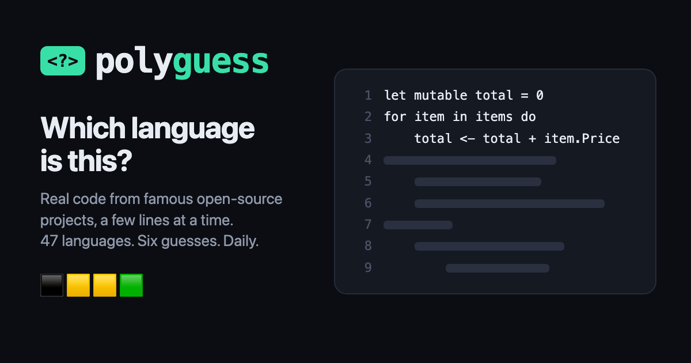

# polyguess

[](https://github.com/SAMARTHJAISWAL/polyguess/actions/workflows/ci.yml)
[](https://polyguess.vercel.app/)
[](LICENSE)

**A daily game for programmers. You see real code from a well-known open-source project, a few lines at a time. Which language is it?**

You start with 3 lines and get six guesses. Every wrong guess shows more of the snippet, up to 14 lines. There are 47 languages, from Python and Go to Erlang, Prolog, Verilog and x86 assembly.

**[Play today's snippet →](https://polyguess.vercel.app/)**

[](https://polyguess.vercel.app/)

## How it plays

| | |
|---|---|
| 🟩 | the right language |
| 🟨 | wrong, but a close relative: same family, such as Rust when the answer is Zig |
| ⬛ | wrong family |
| ⬜ | skipped: costs a guess, shows more code |

Hidden lines appear as bars matching each line's length and indentation, so you can read the shape of the code before you see it. Your result shares without spoilers:

```
polyguess #12 3/6 · 7 lines needed
⬛🟨🟩
https://polyguess.vercel.app/
```

Your streak and stats stay in your browser. Past days are in the 📅 archive.

## Every snippet is real

There are no made-up examples. Each puzzle is 14 consecutive lines of a real file in a real project, such as ripgrep, Flask, Rails, the Erlang/OTP standard library, Phoenix, the Zig standard library, PostgreSQL's regression tests or OpenZeppelin. When you finish, the page links to those exact lines.

[`data/puzzles.json`](data/puzzles.json) holds the 94 snippets, and each one is checked:

- **Pinned:** each snippet records the commit it came from. CI downloads every file at that commit and fails if a single character differs ([`scripts/snippets.mjs`](scripts/snippets.mjs)).
- **Licensed:** each snippet comes from a project under a permissive licence (MIT, Apache-2.0, BSD, ISC, Zlib, Boost, PostgreSQL, Artistic-2.0 or the Unlicense). The licence is shown next to the credit. All 62 projects are listed under [Credits](#credits).
- **No giveaways:** a snippet is rejected if it names a language (`kotlinx`, `golang`), mentions a file extension or a licence header, or starts with a shebang ([`src/puzzles.js`](src/puzzles.js)).
- **Spread out:** you see all 47 languages once before any repeats, and two days in a row never share a family. The tests check both.

## Add a snippet

[Suggest one with a permalink](https://github.com/SAMARTHJAISWAL/polyguess/issues/new?template=snippet.yml), or open a pull request:

```sh
# find candidate 14-line windows in a repository (any GitHub token avoids rate limits)
GITHUB_TOKEN=$(gh auth token) node scripts/scout.mjs Rust BurntSushi/ripgrep crates/core

# add {lang, repo, sha, path, start, license} to data/puzzles.json, then
npm run snippets   # fills in the code from the source and validates it
npm test
```

Good snippets look ordinary for the first three lines and then reveal something characteristic.

## Development

There are no dependencies. It's plain ES modules and Node 18 or newer for the tests.

```sh
npm test        # rules, search, schedule, and every snippet's validity
npm run check   # re-download every snippet and compare it with the source
npm run build   # the static site, into _site/
```

## Credits

The snippets are short excerpts, each credited and linked back to its exact lines, from:

[apache/groovy](https://github.com/apache/groovy) (Apache-2.0) · [apple/swift-algorithms](https://github.com/apple/swift-algorithms) (Apache-2.0) · [axios/axios](https://github.com/axios/axios) (MIT) · [BurntSushi/ripgrep](https://github.com/BurntSushi/ripgrep) (Unlicense OR MIT) · [colinhacks/zod](https://github.com/colinhacks/zod) (MIT) · [crystal-lang/crystal](https://github.com/crystal-lang/crystal) (Apache-2.0) · [dahlbyk/posh-git](https://github.com/dahlbyk/posh-git) (MIT) · [dart-lang/core](https://github.com/dart-lang/core) (BSD-3-Clause) · [dlang/phobos](https://github.com/dlang/phobos) (BSL-1.0) · [dotnet/fsharp](https://github.com/dotnet/fsharp) (MIT) · [dotnet/runtime](https://github.com/dotnet/runtime) (MIT) · [elixir-lang/elixir](https://github.com/elixir-lang/elixir) (Apache-2.0) · [elm/core](https://github.com/elm/core) (BSD-3-Clause) · [erlang/otp](https://github.com/erlang/otp) (Apache-2.0) · [FluxML/Flux.jl](https://github.com/FluxML/Flux.jl) (MIT) · [fortran-lang/fpm](https://github.com/fortran-lang/fpm) (MIT) · [funcool/cuerdas](https://github.com/funcool/cuerdas) (BSD-2-Clause) · [gin-gonic/gin](https://github.com/gin-gonic/gin) (MIT) · [gleam-lang/stdlib](https://github.com/gleam-lang/stdlib) (Apache-2.0) · [google/guava](https://github.com/google/guava) (Apache-2.0) · [google/leveldb](https://github.com/google/leveldb) (BSD-3-Clause) · [haskell/containers](https://github.com/haskell/containers) (BSD-3-Clause) · [JamesNK/Newtonsoft.Json](https://github.com/JamesNK/Newtonsoft.Json) (MIT) · [janestreet/base](https://github.com/janestreet/base) (MIT) · [jart/sectorlisp](https://github.com/jart/sectorlisp) (ISC) · [jashkenas/coffeescript](https://github.com/jashkenas/coffeescript) (MIT) · [jaspervdj/hakyll](https://github.com/jaspervdj/hakyll) (BSD-3-Clause) · [jqlang/jq](https://github.com/jqlang/jq) (MIT) · [JuliaLang/julia](https://github.com/JuliaLang/julia) (MIT) · [Kong/kong](https://github.com/Kong/kong) (Apache-2.0) · [Kotlin/kotlinx.coroutines](https://github.com/Kotlin/kotlinx.coroutines) (Apache-2.0) · [laravel/framework](https://github.com/laravel/framework) (MIT) · [libuv/libuv](https://github.com/libuv/libuv) (MIT) · [lpil/wisp](https://github.com/lpil/wisp) (Apache-2.0) · [microsoft/vscode](https://github.com/microsoft/vscode) (MIT) · [mojolicious/mojo](https://github.com/mojolicious/mojo) (Artistic-2.0) · [nextjournal/clerk](https://github.com/nextjournal/clerk) (ISC) · [nim-lang/Nim](https://github.com/nim-lang/Nim) (MIT) · [ninenines/cowboy](https://github.com/ninenines/cowboy) (ISC) · [nlohmann/json](https://github.com/nlohmann/json) (MIT) · [nvm-sh/nvm](https://github.com/nvm-sh/nvm) (MIT) · [odin-lang/Odin](https://github.com/odin-lang/Odin) (Zlib) · [OpenZeppelin/openzeppelin-contracts](https://github.com/OpenZeppelin/openzeppelin-contracts) (MIT) · [phoenixframework/phoenix](https://github.com/phoenixframework/phoenix) (MIT) · [postgres/postgres](https://github.com/postgres/postgres) (PostgreSQL) · [psf/requests](https://github.com/psf/requests) (Apache-2.0) · [purescript/purescript-prelude](https://github.com/purescript/purescript-prelude) (BSD-3-Clause) · [r-lib/devtools](https://github.com/r-lib/devtools) (MIT) · [racket/racket](https://github.com/racket/racket) (MIT OR Apache-2.0) · [rails/rails](https://github.com/rails/rails) (MIT) · [ruricolist/serapeum](https://github.com/ruricolist/serapeum) (MIT) · [rxi/lume](https://github.com/rxi/lume) (MIT) · [scala/scala](https://github.com/scala/scala) (Apache-2.0) · [SDWebImage/SDWebImage](https://github.com/SDWebImage/SDWebImage) (MIT) · [spring-projects/spring-framework](https://github.com/spring-projects/spring-framework) (Apache-2.0) · [SWI-Prolog/swipl-devel](https://github.com/SWI-Prolog/swipl-devel) (BSD-2-Clause) · [symfony/symfony](https://github.com/symfony/symfony) (MIT) · [tidyverse/ggplot2](https://github.com/tidyverse/ggplot2) (MIT) · [tigerbeetle/tigerbeetle](https://github.com/tigerbeetle/tigerbeetle) (Apache-2.0) · [vlang/v](https://github.com/vlang/v) (MIT) · [YosysHQ/picorv32](https://github.com/YosysHQ/picorv32) (ISC) · [ziglang/zig](https://github.com/ziglang/zig) (MIT)

polyguess itself is [MIT](LICENSE). The snippets remain under their projects' own licences.
